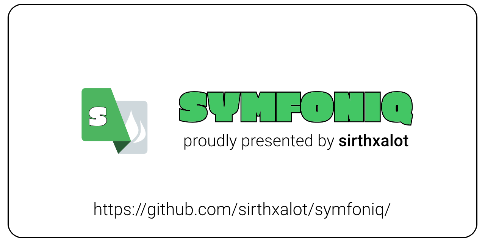

## Introduction

Symfoniq lays out a pragmatic approach to developing web applications with Symfony. It is a simple but expressive and elegant demonstration of how to build scalable and robust applications following best practices and design patterns.

My goal is to use modern technologies the right way by handling data on the client and server sides whenever it's appropriate.

The documentation makes it a breeze to learn more about the application and the Symfony PHP framework. Spiked with tips and tricks, it will turn you into an expert in no time.

## Features

* **Modern Technologies**: Future-proof software like Docker, Vite, TailwindCSS and Vue.js are ready to show off their skills.

* **Fast and Secure**: Well balanced application that handles data fast but also keeps everything secure. Includes an administration panel and role-based authentication.

* **I18n Support**: Supports a worldwide audience and makes translation effortless.

* **Blogger Integration**: Consume the Blogger REST APIs to fetch and translate blog posts or compare versions.

* **Search**: Includes Meilisearch to index and search blog posts.

## Official Documentation

Our [official documentation] is the perfect starting point, in
order to learn how to [install], setup or use Symfoniq from 
scratch. Whether if you are a beginner or an advanced user does 
not matter, you will find what you need to know and become a 
master in no time.

## Issue Tracking

The [issue tracker] is meant in order to report bugs, request 
features or submitting a pull request. But please respect the 
following restrictions:

- Please **do not** report any security vulnerabilities (read [our security policy]).

- Please **do not** derail or troll issues. Keep the discussion on topic and
  respect the opinions of others.

- Please **do not** use the issue tracker for personal support requests
  (use our [discussion forum]).

- Please **do not** open issues or pull requests regarding third party code
  e.g. Symfony (open them in their respective repositories).

## Contributing

Want to get involved? Thanks! We're actively looking for folks
interested in helping out and there are plenty of ways you can help!
But, in order to be a part of our community you must follow and respect
our [code of conduct] and [contribution guideline].

## License

Symfoniq is open-sourced software licensed under the [MIT license].

<!--                  That's all folks!                 -->

[code of conduct]: https://sirthxalot.github.io/symfoniq/contribute/code-of-conduct
[contribution guideline]: https://sirthxalot.github.io/symfoniq/contribute
[discussion forum]: https://github.com/sirthxalot/symfoniq/discussions
[install]: https://sirthxalot.github.io/symfoniq/guide/1.0/install
[issue tracker]: https://github.com/sirthxalot/symfoniq/issues
[mit license]: LICENSE.md
[official documentation]: https://sirthxalot.github.io/symfoniq
[our security policy]: https://github.com/sirthxalot/symfoniq/blob/main/.github/SECURITY.md
