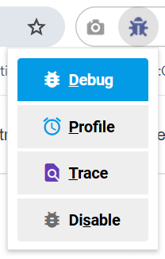
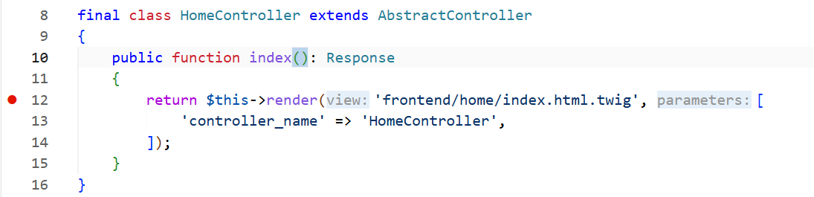
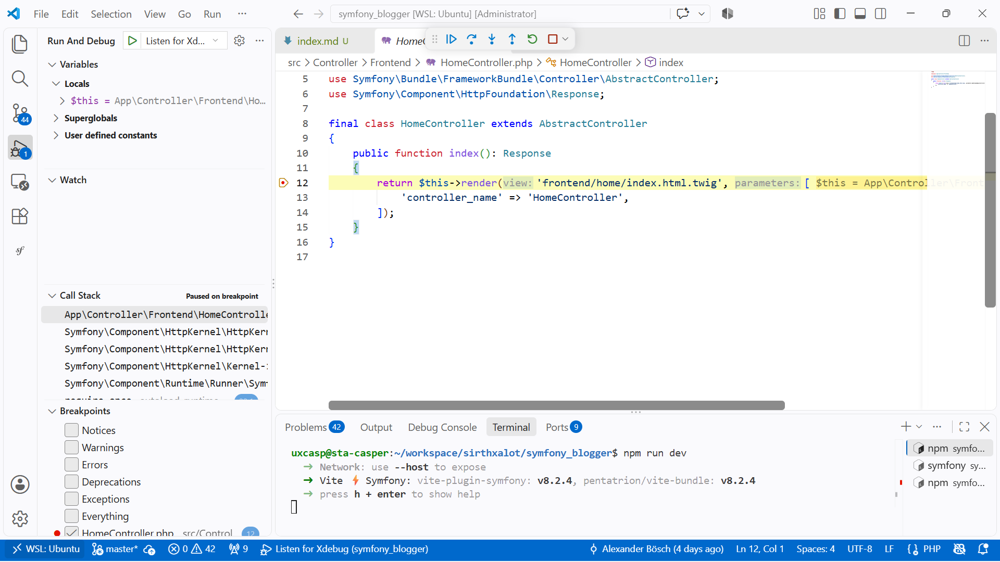

<script setup>
import { useData } from 'vitepress'
const { site } = useData()
</script>

# How to Code

## Common Standards

{{ site.title }} is a software made with Symfony and follows their convention whenever it can. This is why it follows the [PSR-12] coding standard and the [PSR-4] autoloading standard. So before you begin, you should be familiar with the [Symfony documentation]. 

And if you would like to tune your skills, you should definitely check out these bad boys:
- [PHP Design Patterns](https://refactoring.guru/design-patterns/php)
- [Coding Standards](https://symfony.com/doc/current/contributing/code/standards.html)
- [Symfony Conventions]
- [Best Practices](https://symfony.com/doc/current/best_practices.html)

### Key Symfony Conventions to keep in mind:
- **Yoda Conditions:** Always place the expression/literal first when comparing variables (e.g., `if (null === \$value)` or `if (10 === \$count)`).
- **Error Messages:** Exception and error messages must be formatted using `sprintf()`, start with a capital letter, and end with a period. Use double quotes (`"`) instead of backticks (\`) for technical elements.
- **No redundancy:** Only add a PHPDoc block if it provides information that is not already clear from native PHP type hints.

## Editorconfig

[EditorConfig] helps maintain consistent coding styles for multiple developers working on the same project across various editors and IDEs. The EditorConfig project consists of a file format for defining coding styles and a collection of text editor plugins that enable editors to read the file format and adhere to defined styles.

Checkout the `.editorconfig` file to get more information about the project's definition.

Ensure that you have activated and installed the [EditorConfig extension] for Visual Studio Code, when coding.

## PHP Code Style Fixing

Don't worry if your code styling isn't perfect! [PHP CS Fixer] will automatically merge any style fixes into the repository after pull requests are merged or pushed on the `main` and `release` branch. This allows us to focus on the content of the contribution and not the code style.

### Check for Fixing

[The `check` command] won’t apply any changes, but will only print analysis result:

```bash
./bin/php-cs-fixer check
```

### Fixing Coding Standard

[The `fix` command] tries to fix as much coding standards problems as possible:

```bash
./bin/php-cs-fixer fix
```

## Profiling

The [profiler] is a powerful development tool that gives detailed information about the execution of any request.

Browse the `/_profiler` URL to see all profiles.

## Deptrac

[Deptrac] is a static code analysis tool for PHP that helps you communicate, visualize and enforce architectural decisions in your projects.

You can run the following command in order to analyse the source code and check for violations:

```bash
./bin/deptrac
```

## Code Deprecation

From time to time, some classes and/or methods are deprecated; that happens when a feature implementation cannot be changed because of backward compatibility issues, but we still want to propose a "better" alternative. In that case, the old implementation can be deprecated. 

Deprecation must only be introduced on the next minor version of the impacted source code. It can exceptionally be introduced on previously supported versions if it is critical.

A feature is marked as deprecated by adding a `@deprecated` PHPDoc to relevant classes, methods, properties, ...:

```php
/**
 * @deprecated since 1.0.0.
 */
```

The deprecation message must indicate the version in which the feature was deprecated, and whenever possible, how it was replaced:

```php
/**
 * @deprecated since 1.0.0, use alternative() instead.
 */
```

A deprecation must also be triggered to help people with the migration (uses [symfony/deprecation-contracts]):

::: code-group
```php [Class]
trigger_deprecation(
    'sirthxalot/symfoniq',
    '1.0',
    'The "%s" class is deprecated, use "Acme\NewClass" instead.',
    __CLASS__
);
```

```php [Method]
trigger_deprecation(
    'sirthxalot/symfoniq',
    '1.0',
    'The "%s()" method is deprecated, use "Acme\NewClass::newMethod()" instead.',
    __METHOD__
);
```
:::

## PHP DocBlocks

PHP documentation blocks (DocBlocks) should follow [Symfony conventions].

::: code-group
```php [PHP Method]
/**
 * A simple description of what the method does.
 *
 * @since 1.0.0
 * @version 1.6.5
 *
 * @deprecated since 1.3.1, use alternative() instead.
 *
 * @todo Something that needs to be done.
 * @todo Something that needs to be done later.
 *
 * @see \SomeSortOfEvent
 *
 * @param string|array $abstract "Foo" or ['foo']
 * @param string $locale "en_US"
 * @param \Closure|string|null $concrete Always place null at the end of types!
 * @param bool $shared
 *
 * @return void
 *
 * @throws \Exception
 */
```

```php [PHP Class]
/**
 * Coding standards demonstration class.
 *
 * This description provides additional high-level context about the
 * service or core utility that cannot be guessed by the class name.
 */
```

```php [Generics Array]
/**
 * Retrieve a list of users.
 *
 * @return array<int, User> A list of User objects indexed by their ID
 */
public function findActiveUsers(): array
```

```php [Shape / Associative Array]
/**
 * Initializes the application metadata configuration.
 *
 * @param array{name: string, version: string, debug: bool} $config
 */
public function initializeApp(array $config): void
```
:::

## Debugging

### How to Debug with Xdebug

We use [Xdebug] within Visual Studio Code to debug the code. In this article, we don't cover every aspect of debugging; it's just a general guide to get you started. 

Before we start, ensure you have installed the [Xdebug PHP extension]. To debug, we also need to ensure we install the [Xdebug Chrome Extension](https://chromewebstore.google.com/detail/xdebug-chrome-extension/oiofkammbajfehgpleginfomeppgnglk) and set it to Debug:



Next, we need to ensure that you have installed the [PHP Debug extension for Visual Studio Code]. By pressing `F5` within Visual Studio Code, we enable the listener for Xdebug. `Shift + F5` will disable the listener. 

Let's set a breakpoint within the `src/Controller/Frontend/HomeController.php` by clicking next to the line number we want to debug:



If you now load the homepage, you will see how the profiling works:



### Symfony Profiling

The [profiler] is a powerful development tool that gives detailed information about the execution of any request. Browse the [`/_profiler`](http://localhost:8000/_profiler) URL to see all profiles.

<!--                  That's all folks!                 -->

[deptrac]: https://deptrac.github.io/deptrac/
[editorconfig extension]: https://marketplace.visualstudio.com/items?itemName=EditorConfig.EditorConfig
[editorconfig]: https://editorconfig.org/
[php cs fixer]: https://cs.symfony.com/
[php cs fixer]: https://cs.symfony.com/
[php debug extension for visual studio code]: https://marketplace.visualstudio.com/items?itemName=xdebug.php-debug
[phpstan]: https://phpstan.org/
[profiler]: https://symfony.com/doc/current/profiler.html
[profiler]: https://symfony.com/doc/current/profiler.html
[psr-12]: https://www.php-fig.org/psr/psr-12/
[psr-4]: https://www.php-fig.org/psr/psr-4/
[symfony conventions]: https://symfony.com/doc/current/contributing/code/conventions.html
[symfony documentation]: https://symfony.com/doc
[symfony/deprecation-contracts]: https://github.com/symfony/deprecation-contracts
[the `check` command]: https://cs.symfony.com/doc/usage.html#the-check-command
[the `fix` command]: https://cs.symfony.com/doc/usage.html#the-fix-command
[xdebug php extension]: /contribute/dev/setup/#xdebug
[xdebug]: https://xdebug.org/
